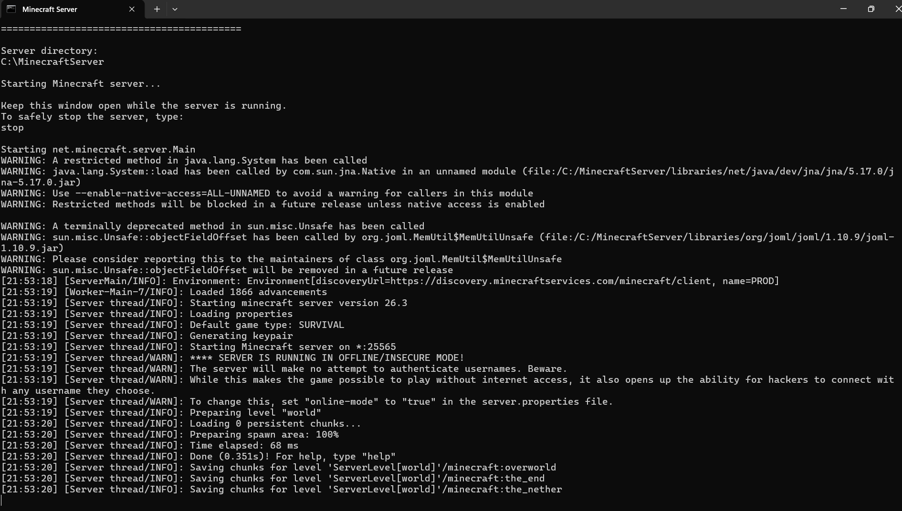
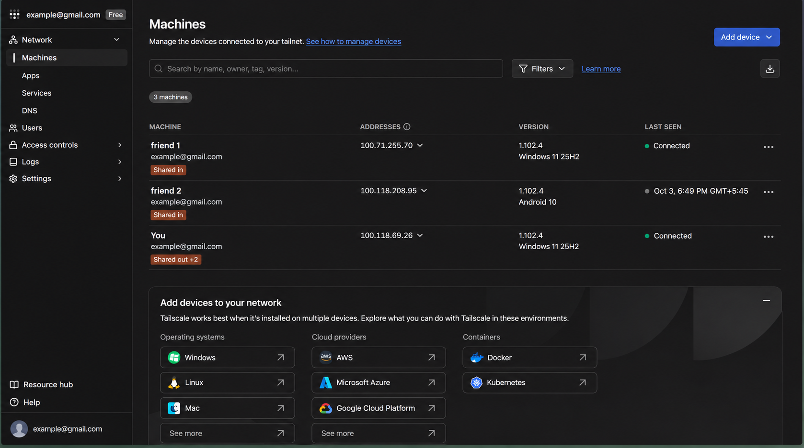
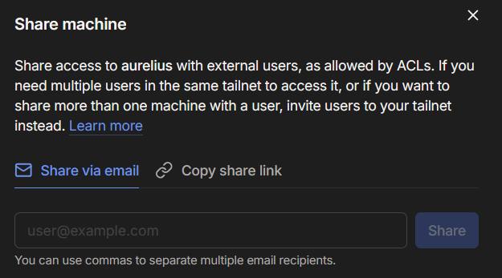
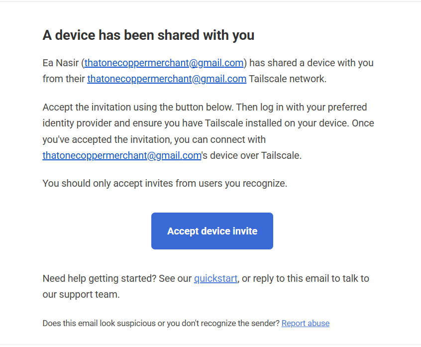

# Windows Server Setup

Stop by step guide on how to host private Minecraft Server Java ediiton, locally.

In case of any errors, Check [troubleshooting.md](../docs/troubleshooting.md)

## 1. Requirements

* Windows 10/11 PC
* Minecraft Java Edition
* Java installed
* Internet connection
* Tailscale account
* Administrator access to Windows

---

## 2. Install Java

Open PowerShell and check:

```powershell
java -version
```

If Java is not installed, install a Java version compatible with your Minecraft server version.

[Download Java](https://www.java.com/en/download/)

After installation, verify again:

```powershell
java -version
```
Java Version should be compatible with Minecraft Server Version. For Example, Java 25 is Compatible with Minecraft 26.3 Version. Just download latest version of Minecraft Server and Java, They're usually compatible.

---

## 3. Create the Server Folder

Create:

```text
C:\MinecraftServer
```

Open PowerShell:

```powershell
mkdir C:\MinecraftServer
cd C:\MinecraftServer
```

---

## 4. Download the Minecraft Server

Download the Minecraft Java Edition server JAR for the desired version from Mojang's official server download page.

[Minecraft Java Server Download](https://www.minecraft.net/en-us/download/server)

Place it inside:

```text
C:\MinecraftServer
```

Rename it if not already:

```text
server.jar
```

The folder should contain:

```text
C:\MinecraftServer\
└── server.jar
```

---

## 5. Start the Server

Open PowerShell:

```powershell
cd C:\MinecraftServer
```

Start the server:

```powershell
java -Xms2G -Xmx4G -jar server.jar nogui
```

The first startup will generate the required files and then stop because the EULA has not been accepted.

---

## 6. Accept the EULA

Open txt file with notepad:

```text
C:\MinecraftServer\eula.txt
```

Change:

```text
eula=false
```

to:

```text
eula=true
```

Save the file.

---

## 7. Start the Server Again

Run:

```powershell
cd C:\MinecraftServer
java -Xms2G -Xmx4G -jar server.jar nogui
```

You should see:
```bash
Starting minecraft server version 26.3
```

You can stop the server once it's running, from console using:
```text
stop
```
And server will stop.

---

## 8. Configure `server.properties`

Stop the server from its console:

```text
stop
```

Open with notepad:

```text
C:\MinecraftServer\server.properties
```

For a basic private Survival server, use (if not already configured):

```properties
gamemode=survival
difficulty=normal
max-players=6
server-port=25565
server-ip=
online-mode=true
white-list=true
```

Save the file.

Keep:

```properties
server-ip=
```

blank.

---

## 9. Start the Server

```powershell
cd C:\MinecraftServer
java -Xms2G -Xmx4G -jar server.jar nogui
```

Minecraft will generate the world.



The server directory should now contain files/folders similar to:

```text
C:\MinecraftServer\
├── server.jar
├── eula.txt
├── server.properties
├── world\
├── logs\
├── whitelist.json
└── ops.json
```

---

## 10. Test the Server Locally

Open Minecraft Java Edition on the server PC.

Go to:

```text
Multiplayer → Add Server
```

Enter:

```text
localhost:25565
```

Connect and verify that the server works.

After testing, stop the server:

```text
stop
```

---

## 11. Install Tailscale

Install Tailscale on the Windows server PC.

[Tailscale Download](https://tailscale.com/download)

Sign in using the account that will manage the Minecraft Tailnet.

Install Tailscale on every friend's PC that will connect to the server and create an account.

From admin-console of tailscale in a browser Share your device through email or link with your friends.

 

   

Make sure all devices are connected to the same Tailnet after accepting invitation mail from friend's tailscale account.

   

Each time to keep server online, Admin must be online and connected to tailnet. And to join the server, each devices also must be connected to tailscale tailnet and online.

---

## 12. Find the Server's Tailscale IP

On the Windows server PC, open PowerShell:

```powershell
tailscale status
```

Then:

```powershell
tailscale ip
```

Find the server's Tailscale IPv4 address.

It will look similar to:

```text
100.x.x.x
```

Example:

```text
100.118.69.26
```

### OR 
you can check device's ip in tailscale --> admin-console --> Machines 

Use the address shown on your own machine.

---

## 13. Test Tailscale

From another computer on the same Tailnet:

```powershell
tailscale ping <SERVER-TAILSCALE-IP>
```

Example:

```powershell
tailscale ping 100.118.69.26
```

Make sure the connection succeeds.

---

## 14. Test Minecraft Through Tailscale

Start the Minecraft server:

```powershell
cd C:\MinecraftServer
java -Xms2G -Xmx4G -jar server.jar nogui
```

On another Tailnet-connected Windows PC, run:

```powershell
Test-NetConnection <SERVER-TAILSCALE-IP> -Port 25565
```

Example:

```powershell
Test-NetConnection 100.118.69.26 -Port 25565
```

Confirm:

```text
TcpTestSucceeded : True
```

---

## 15. Connect to the Server

On each friend's Minecraft Java Edition client:

```text
Multiplayer
→ Add Server
```

Enter tailscale ip of host's machine:

```text
<SERVER-TAILSCALE-IP>:25565
```

Example:

```text
100.118.69.26:25565
```

Connect.

---

## 16. Add players to server

If the players joining Server are not using official Minecraft launcher or official microsoft account they may not be able to join. But if you want them to be able to play as well, from server.properties set:

```text
online-mode= false
```

From the Minecraft server console:

Add each trusted player:

```text
whitelist add PlayerName
```

If you don't want to keep repeating this and allow anyone to join server without having to add their username manually, from server.properties set:

```text
whitelist= false
```
However there is a risk of 3rd party exploitation with change in these settings. If server is accessible by untrustworthy party. 

---

## 17. Give OP to Server Administrators

Only for trusted administrators:

```text
op PlayerName
```

To remove OP:

```text
deop PlayerName
```

---

## 18. Windows Firewall

Keep Windows Firewall enabled.

If Windows asks whether Java/Minecraft should be allowed through the firewall, allow the required connection rather than disabling the firewall.

Do not disable Windows Firewall completely.

---

## 19. Final Server Start Command

Whenever you want to start the server:

```powershell
cd C:\MinecraftServer
java -Xms2G -Xmx4G -jar server.jar nogui
```

Or download [start-server.bat](../scripts/start-server.bat) and keep it on

```text
C:\MinecraftServer
```
for ease.

NOTE: -Xms2G -Xmx4G allocates total RAM for the server from the computer, Essentially meaning 2-4 GB of RAM. If you can allocate more then it's better for no lag during play and for multiple users. You can make it -Xms4G -Xmx6G as per your necessity.

Leave the server console running while people are playing.

---

## 20. Safely Stop the Server

When finished:

```text
stop
```

Wait until Minecraft completely shuts down before closing the terminal.

---

## 21. Final Connection

Friends should connect using:

```text
<SERVER-TAILSCALE-IP>:25565
```

For example:

```text
100.118.69.26:25565
```

No router port forwarding is required.

The completed setup is:

```text
Host PC
├── Minecraft Server
│   └── :25565
└── Tailscale
    └── 100.x.x.x

Friends
└── Tailscale
    └── Minecraft → SERVER-TAILSCALE-IP:25565
```